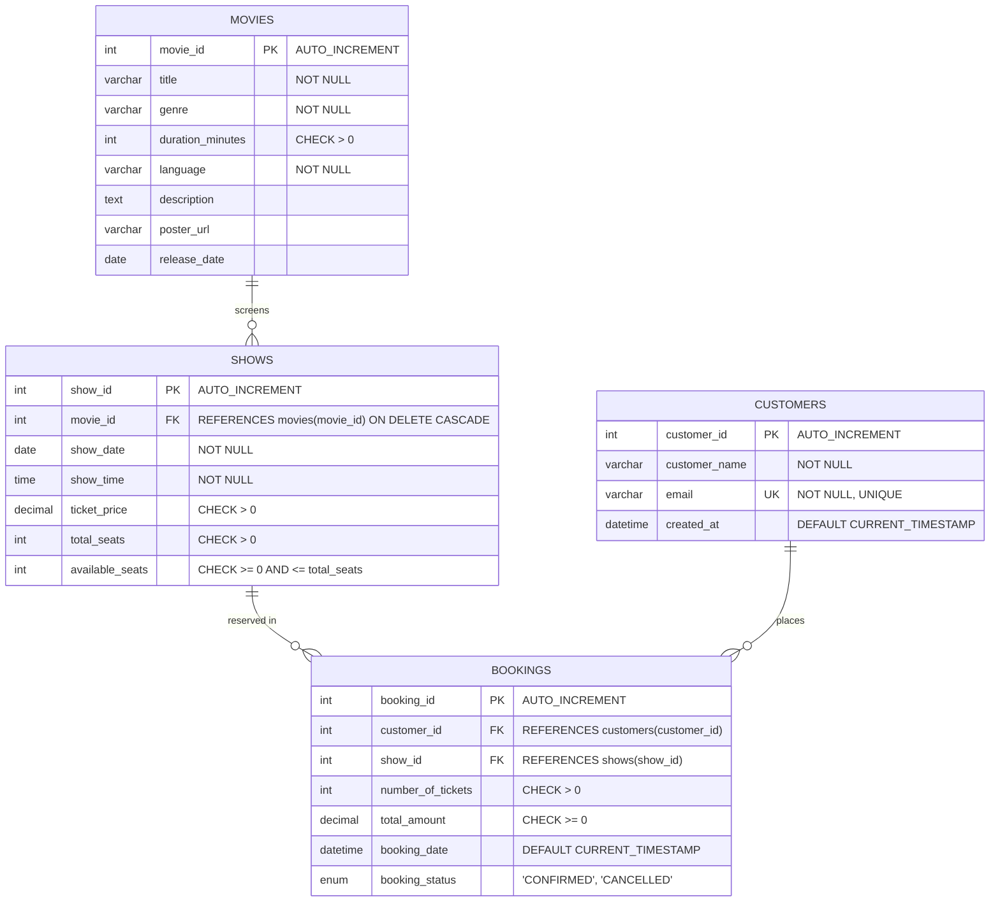

# 🎬 Movie Ticket Booking System

## DBMS Capstone Project

A complete, web-based movie ticket booking system built as a Database Management Systems (DBMS) capstone project for B.Tech Computer Science and Engineering. The application provides an end-to-end cinema reservation workflow allowing users to browse now-showing movies, select screening dates and showtimes, reserve tickets with automatic price calculations, look up booking history, and cancel reservations with automated seat restoration. It also features a secure administrative console with metrics analytics, catalog CRUD management, show scheduling, and booking oversight.

---

## 🌟 Key Features

- **Dynamic Movie Catalog**: Browse active cinema releases with poster artwork, runtime, language badges, and synopsis.
- **Real-Time Search & Filtering**: Instant client-side search by movie title, genre, and language without page reloads.
- **Showtime Selection & Seat Availability**: Live visibility into screening schedules, ticket pricing, and remaining seat counts.
- **Interactive Ticket Booking**: Flexible seat quantity selection (1–10 tickets) with live subtotal calculation and client/server validation.
- **ACID Transaction Booking Engine**: Atomic database transactions that deduct available seats and create booking records simultaneously.
- **Booking Management & Self-Service Lookup**: Search reservation history by customer email address and review ticket statuses (`CONFIRMED` or `CANCELLED`).
- **Cancellation & Seat Restoration**: One-click cancellation with transactional rollback and automatic seat replenishment.
- **Secure Admin Panel**: Token-based administrative console for managing movies, scheduling showtimes, reviewing customer bookings, and monitoring theater revenues.
- **Dark Cinema-Themed Responsive UI**: Polished glassmorphism design built using modern vanilla CSS Grid and Flexbox.

---

## 💻 Technologies Used

| Technology | Purpose |
|---|---|
| **HTML5 & Vanilla JavaScript** | Accessible DOM structure and client-side application logic |
| **Vanilla CSS3** | Custom dark cinema theme, CSS grid/flexbox, animations, and responsive layouts |
| **Node.js** | Server-side JavaScript runtime environment |
| **Express.js** | Lightweight RESTful routing and static asset web server |
| **MySQL 8.0+** | Relational Database Management System (RDBMS) |
| **mysql2** | High-performance MySQL driver with Promise and connection pooling support |
| **dotenv** | Environment variable management for zero-leak configuration |

---

## 🗄️ Database Design

### Entity-Relationship (ER) Diagram



### Tables Specification

1. **`movies`**
   - Stores metadata regarding movies currently featured in the cinema.
   - Primary Key: `movie_id`.
   - Constraints: `CHECK (duration_minutes > 0)`.
2. **`shows`**
   - Contains scheduled screening times, ticket pricing, and seat tallies for each movie.
   - Primary Key: `show_id`.
   - Foreign Key: `movie_id` references `movies(movie_id)` on delete cascade.
   - Constraints: `CHECK (ticket_price > 0)`, `CHECK (total_seats > 0)`, `CHECK (available_seats >= 0)`, `CHECK (available_seats <= total_seats)`.
3. **`customers`**
   - Maintains registered customer profiles identified by a unique email.
   - Primary Key: `customer_id`.
   - Constraints: Unique constraint on `email`.
4. **`bookings`**
   - Tracks ticket purchasing transactions between customers and scheduled shows.
   - Primary Key: `booking_id`.
   - Foreign Keys: `customer_id` references `customers(customer_id)`, `show_id` references `shows(show_id)`.
   - Constraints: `CHECK (number_of_tickets > 0)`, `CHECK (total_amount >= 0)`.

### Relationships
- **Movies to Shows (1:N)**: One movie can have multiple screening times on different dates, while each show belongs to exactly one movie.
- **Customers to Bookings (1:N)**: One customer can create multiple booking orders over time, while each booking order belongs to exactly one customer.
- **Shows to Bookings (1:N)**: One scheduled show can accommodate multiple customer bookings until total seating capacity is exhausted.

### Database Normalization (3NF)

The relational schema is strictly normalized up to **Third Normal Form (3NF)**:

1. **First Normal Form (1NF)**:
   - All attribute values are atomic (e.g., customer name and email are singular values; show date and show time are separated into dedicated columns).
   - There are no repeating groups or multi-valued columns.
   - Each table possesses an identified Primary Key.

2. **Second Normal Form (2NF)**:
   - Meets all 1NF conditions.
   - No partial dependencies exist: because all tables utilize single-column surrogate primary keys (`movie_id`, `show_id`, `customer_id`, `booking_id`), every non-key attribute is fully functionally dependent on the entire primary key.

3. **Third Normal Form (3NF)**:
   - Meets all 2NF conditions.
   - Eliminates transitive dependencies: non-key attributes depend solely on the primary key, and not on other non-key attributes. For instance, customer details (name, email) are isolated in the `customers` table rather than replicated inside `bookings`. Similarly, movie duration and language are stored in `movies`, rather than duplicated across `shows` or `bookings`.

---

## ⚙️ Prerequisites

Before installing, ensure the following software is installed on your computer:

- **Node.js**: Version 18.0.0 or later ([Download Node.js](https://nodejs.org/))
- **MySQL Community Server**: Version 8.0 or later ([Download MySQL](https://dev.mysql.com/downloads/mysql/))
- **MySQL Workbench** (Recommended GUI): ([Download MySQL Workbench](https://dev.mysql.com/downloads/workbench/))
- **VS Code** (Recommended Code Editor): ([Download Visual Studio Code](https://code.visualstudio.com/))

---

## 🚀 Installation & Setup

### Step 1: Navigate to Project Directory
Open your terminal or PowerShell and change directory to the project folder:
```bash
cd "c:\Users\AKSHAT TOMAR\Desktop\DBMS\movie-ticket-booking"
```

### Step 2: Initialize Database in MySQL
1. Launch **MySQL Workbench** and establish a connection to your local MySQL instance.
2. Open `database/schema.sql` and click **Execute (⚡)** to create the database `movie_ticket_booking`, tables, constraints, indexes, views, stored procedures, and triggers.
3. Open `database/seed.sql` and click **Execute (⚡)** to populate the database with initial movies, shows, and customer booking data.

*Alternatively, run via MySQL Command Line Client:*
```bash
mysql -u root -p < database/schema.sql
mysql -u root -p < database/seed.sql
```

### Step 3: Configure Environment Variables
Copy `.env.example` to create your local `.env` configuration file:
```bash
cp .env.example .env
```
Open `.env` and enter your local MySQL credentials:
```env
DB_HOST=localhost
DB_PORT=3306
DB_USER=root
DB_PASSWORD=your_actual_mysql_password
DB_NAME=movie_ticket_booking
PORT=3000
ADMIN_USERNAME=admin
ADMIN_PASSWORD=admin123
```

### Step 4: Install Dependencies
Install the required Node.js packages (`express`, `mysql2`, `dotenv`):
```bash
npm install
```

### Step 5: Start the Server
Run the production server:
```bash
npm start
```
Or run in development mode with automatic restarts:
```bash
npm run dev
```

### Step 6: Open the Application
Launch your web browser and navigate to:
- **Public Home Portal**: [http://localhost:3000](http://localhost:3000)
- **Admin Management Portal**: [http://localhost:3000/admin](http://localhost:3000/admin)

---

## 🔑 Administrative Access

Administrative credentials can be customized inside the `.env` file:
- **Default Username**: `admin`
- **Default Password**: `admin123`
- **Admin URL**: [http://localhost:3000/admin](http://localhost:3000/admin)

---

## 📁 Project Structure

```text
movie-ticket-booking/
├── .env
├── .env.example
├── .gitignore
├── package.json
├── README.md
├── server.js
├── config/
│   └── db.js                 # MySQL2 connection pool configuration
├── controllers/
│   ├── adminController.js    # Admin authentication, stats, and CRUD handlers
│   ├── bookingController.js  # Transactional booking creation and cancellation
│   ├── movieController.js    # Movie catalog retrieval and details
│   └── showController.js     # Showtimes retrieval by movie ID
├── database/
│   ├── queries.sql           # 14 DBMS analytical and operational queries
│   ├── schema.sql            # DDL: schema, tables, constraints, view, procedure, trigger
│   └── seed.sql              # DML: initial sample dataset for movies, shows, and bookings
├── middleware/
│   └── authMiddleware.js     # Bearer token verification middleware for admin routes
├── public/
│   ├── admin.html            # Admin dashboard and management portal
│   ├── bookings.html         # User booking search and ticket cancellation
│   ├── index.html            # Public home page with movie showcase
│   ├── movie.html            # Movie details, show selection, and booking checkout
│   ├── css/
│   │   ├── admin.css         # Admin console layout and component styles
│   │   └── style.css         # Dark cinema design system, tokens, and responsive styles
│   └── js/
│       ├── admin.js          # Admin token auth, metric stats, and catalog CRUD
│       ├── bookings.js       # Customer booking lookup and cancellation
│       ├── main.js           # Home page movie catalog loading and search filtering
│       └── movie.js          # Details rendering, show selection, and checkout flow
└── routes/
    ├── adminRoutes.js        # Protected administrative routes
    ├── bookingRoutes.js      # Booking endpoints (create, lookup, cancel)
    ├── movieRoutes.js        # Public movie catalog endpoints
    └── showRoutes.js         # Public showtimes endpoints
```

---

## 📡 REST API Reference

### Public Endpoints

| Method | Endpoint | Request Body / Parameters | Description |
|---|---|---|---|
| `GET` | `/api/movies` | None | Returns list of all active movies |
| `GET` | `/api/movies/:id` | `:id` (Movie ID) | Returns movie details by ID |
| `GET` | `/api/shows/movie/:movieId` | `:movieId` (Movie ID) | Returns scheduled shows for a movie |
| `POST` | `/api/bookings` | `{ customer_name, email, show_id, number_of_tickets }` | Atomically books tickets and decrements seats |
| `GET` | `/api/bookings?email=...` | `email` query parameter | Retrieves booking history for a customer email |
| `PUT` | `/api/bookings/:id/cancel` | `:id` (Booking ID) | Cancels reservation and restores show seats |

### Admin Endpoints (Require Bearer Token)

| Method | Endpoint | Authorization | Description |
|---|---|---|---|
| `POST` | `/api/admin/login` | None | Authenticates admin credentials, returns session token |
| `POST` | `/api/admin/logout` | `Bearer <token>` | Terminates administrative session token |
| `GET` | `/api/admin/verify` | `Bearer <token>` | Validates current token status |
| `GET` | `/api/admin/movies` | `Bearer <token>` | Fetches full movie catalog for administrative viewing |
| `POST` | `/api/admin/movies` | `Bearer <token>` | Inserts a new movie into the theater catalog |
| `PUT` | `/api/admin/movies/:id` | `Bearer <token>` | Updates movie title, duration, poster, or synopsis |
| `DELETE` | `/api/admin/movies/:id`| `Bearer <token>` | Deletes movie from catalog (if no shows scheduled) |
| `POST` | `/api/admin/shows` | `Bearer <token>` | Schedules a new showtime with price and total seats |
| `GET` | `/api/admin/bookings` | `Bearer <token>` | Retrieves all customer bookings across the system |
| `GET` | `/api/admin/stats` | `Bearer <token>` | Computes aggregate counts for movies, bookings, revenue, and tickets |

---

## 🧠 Core SQL Concepts Demonstrated

The project demonstrates 13 essential relational database concepts:

1. **Data Definition Language (DDL)**:
   - Demonstrated in `database/schema.sql` with `CREATE DATABASE`, `CREATE TABLE`, `DROP TABLE`, and `ALTER TABLE`.
2. **Data Manipulation Language (DML)**:
   - Demonstrated in `database/seed.sql` and backend controllers with `INSERT INTO`, `UPDATE`, `DELETE`, and `SELECT`.
3. **Primary Key & Foreign Key Constraints**:
   - Every entity defines a surrogate primary key (`AUTO_INCREMENT`). Referential integrity is guaranteed with foreign keys (`fk_shows_movie`, `fk_bookings_customer`, `fk_bookings_show`).
4. **Data Integrity Constraints (`CHECK`, `NOT NULL`, `UNIQUE`)**:
   - Positive price checks: `ticket_price > 0`.
   - Valid ticket ranges: `number_of_tickets > 0`.
   - Seat boundaries: `available_seats >= 0 AND available_seats <= total_seats`.
   - Unique customer email identity: `email VARCHAR(255) NOT NULL UNIQUE`.
5. **Cascading Referential Actions (`ON DELETE CASCADE`)**:
   - `shows` table foreign key enforces `ON DELETE CASCADE` so deleting a movie removes associated shows.
6. **Relational Table Joins (`INNER JOIN`, `LEFT JOIN`)**:
   - Inner joins consolidate customer, show, and movie records for booking slips.
   - Left outer joins identify unscheduled movies or shows with zero bookings.
7. **Aggregate Functions (`COUNT`, `SUM`, `AVG`, `MIN`, `MAX`)**:
   - Utilized in dashboard analytics to compute gross revenue (`SUM`), total tickets sold (`SUM`), total movies (`COUNT`), and average ticket prices (`AVG`).
8. **Grouping and Group Filtering (`GROUP BY` and `HAVING`)**:
   - Used in `queries.sql` to group sales figures per title and filter repeat buyers having more than one booking (`HAVING COUNT(b.booking_id) > 1`).
9. **Subqueries & Set Membership (`IN`, `NOT IN`, `EXISTS`)**:
   - Analytical queries isolate movies with scheduled screenings that have zero confirmed bookings.
10. **Database Indexing for Query Optimization (`CREATE INDEX`)**:
    - B-Tree indexes created on `movies(title)`, `customers(email)`, `shows(movie_id)`, and `bookings(customer_id)` to speed up lookups.
11. **Database Views (`CREATE VIEW`)**:
    - Created `booking_details_view` to encapsulate 4-table join queries into an accessible virtual table for reporting.
12. **Stored Procedures (`CREATE PROCEDURE`)**:
    - Created `GetMovieRevenue(IN p_movie_id INT)` with parameterized inputs to aggregate revenue dynamically for any movie.
13. **Database Triggers (`CREATE TRIGGER`)**:
    - Created `before_booking_insert` to prevent race-condition overbooking at the database engine level via `SIGNAL SQLSTATE '45000'`.
14. **Transactions & ACID Control (`BEGIN`, `COMMIT`, `ROLLBACK`)**:
    - Implemented in `bookingController.js` to ensure seat deduction and booking insertion succeed or fail as an indivisible unit.

---

## 🛠️ Common Issues & Troubleshooting

- **Error: `connect ECONNREFUSED 127.0.0.1:3306`**
  - **Cause**: MySQL server service is stopped or running on a different port.
  - **Resolution**: Open Windows Services (`services.msc`), find **MySQL80**, and click **Start**. Ensure port 3306 matches your configuration.
- **Error: `Access denied for user 'root'@'localhost'`**
  - **Cause**: Incorrect password provided in `.env`.
  - **Resolution**: Open `.env` and verify `DB_PASSWORD` matches the password configured during MySQL installation.
- **Error: `ER_NOT_SUPPORTED_AUTH_MODE`**
  - **Cause**: MySQL 8.0+ uses `caching_sha2_password` authentication by default.
  - **Resolution**: Execute the following query in MySQL Workbench:
    ```sql
    ALTER USER 'root'@'localhost' IDENTIFIED WITH mysql_native_password BY 'your_password';
    FLUSH PRIVILEGES;
    ```
- **Error: `Port 3000 is already in use`**
  - **Cause**: Another Node.js process or application is occupying port 3000.
  - **Resolution**: Change `PORT=3001` inside your `.env` file and restart.

---

## 🎓 DBMS Viva Examination Guide

This section is tailored to assist students during project viva-voce examinations:

### 1. What is Normalization? Explain 1NF, 2NF, and 3NF using this project.
- **Normalization** is a systematic database design technique that organizes tables to minimize data redundancy and prevent insertion, update, and deletion anomalies.
- **1NF (First Normal Form)**: Attributes must hold atomic (indivisible) values. In our project, instead of storing multiple showtimes inside a single string in the `movies` table, each showtime is stored as a distinct row in the `shows` table.
- **2NF (Second Normal Form)**: The table must be in 1NF and contain no partial dependencies (every non-key attribute must depend on the whole candidate key). Because our tables use single-column primary keys (`booking_id`, `show_id`), partial dependency cannot occur.
- **3NF (Third Normal Form)**: The table must be in 2NF and contain no transitive dependencies ($X \rightarrow Y$ and $Y \rightarrow Z$). For example, customer names and emails depend on `customer_id`, not on `booking_id`. Therefore, customer data is maintained in `customers`, rather than duplicated across `bookings`.

### 2. What are Primary Keys and Foreign Keys? Give examples from the schema.
- **Primary Key (PK)**: A column or set of columns that uniquely identifies each row in a table. It must be `NOT NULL` and `UNIQUE`.
  - *Example*: `movie_id` in `movies`, `booking_id` in `bookings`.
- **Foreign Key (FK)**: A column in one table that references the primary key of another table, establishing a referential constraint between them.
  - *Example*: `show_id` in `bookings` references `show_id` in `shows`.

### 3. What are JOINs? Explain INNER JOIN and LEFT JOIN with project examples.
- **JOIN**: An operation used to combine rows from two or more tables based on a related column between them.
- **INNER JOIN**: Returns only the rows where there is a match in both tables.
  - *Project Example*: Joining `bookings` and `shows` returns only bookings linked to valid shows.
- **LEFT JOIN (Outer Join)**: Returns all rows from the left table and matched rows from the right table. If no match exists, `NULL` values are returned for right table columns.
  - *Project Example*: Joining `movies` with `shows` using a `LEFT JOIN` allows the system to list movies even if no shows have been scheduled for them yet.

### 4. What are Database Transactions? Why are they vital for ticket booking?
- A **transaction** is a sequence of one or more database operations executed as a single logical unit of work.
- In ticket booking, purchasing involves two operations:
  1. Decrementing `available_seats` in the `shows` table.
  2. Inserting a new record into the `bookings` table.
- If the server crashes after decrementing seats but before creating the booking, tickets are lost without generating a receipt. Wrapping both queries in a transaction (`BEGIN TRANSACTION` ... `COMMIT`) guarantees that either both succeed or both are rolled back (`ROLLBACK`), preserving seat consistency.

### 5. What are ACID properties and how does this project ensure them?
- **Atomicity**: The transaction is all-or-nothing. Handled via Node.js `connection.beginTransaction()` and `connection.rollback()`.
- **Consistency**: The database transitions from one valid state to another, satisfying all integrity rules and `CHECK` constraints (e.g., `available_seats >= 0`).
- **Isolation**: Concurrent booking transactions do not interfere with one another. Row-level locks in MySQL InnoDB prevent two users from booking the final seat simultaneously.
- **Durability**: Once a transaction is committed, changes are permanently written to non-volatile storage (via the InnoDB redo log), surviving server reboots.

### 6. What are Indexes and which columns are indexed in this system?
- An **index** is a B-Tree data structure that enables fast retrieval of rows without scanning every row in the table (preventing full table scans).
- Columns indexed in this project:
  - `movies(title)`: Accelerates keyword searches on the catalog.
  - `customers(email)`: Enables instant customer identification during checkout and booking history lookups.
  - `shows(movie_id)` and `shows(show_date)`: Optimizes retrieval of upcoming screenings by movie and date.
  - `bookings(customer_id)` and `bookings(booking_status)`: Speeds up customer booking history queries and revenue analytics.

### 7. What is a Database View? Explain `booking_details_view`.
- A **View** is a virtual table defined by a saved SQL query. It does not store physical data itself, but generates results dynamically when queried.
- `booking_details_view` joins `bookings`, `customers`, `shows`, and `movies`. It simplifies analytical queries by hiding join complexity, allows secure read-only access, and provides a centralized definition for booking records.

### 8. What is a Stored Procedure? Explain `GetMovieRevenue`.
- A **Stored Procedure** is a precompiled collection of SQL statements stored directly in the database engine.
- Advantages include reduced network traffic, improved execution speed due to precompilation, and encapsulation of business logic.
- `GetMovieRevenue(IN p_movie_id INT)` takes a movie ID as an input parameter, aggregates confirmed ticket earnings using `SUM(total_amount)`, and returns the total revenue and booking count directly to the caller.

### 9. What is a Trigger? Explain `before_booking_insert`.
- A **Trigger** is a database callback that automatically executes in response to a specific DML event (`INSERT`, `UPDATE`, `DELETE`) on a table.
- `before_booking_insert` fires before any new row is inserted into `bookings`. It queries `available_seats` for the target show; if available seats are fewer than the requested `number_of_tickets`, it raises a `SIGNAL SQLSTATE '45000'` exception, rejecting the insert at the database kernel level.

### 10. Explain CHECK constraints with examples from this project.
- A **`CHECK` constraint** enforces domain integrity by specifying a condition that must evaluate to true for every inserted or updated row.
- *Examples*:
  - `CONSTRAINT chk_movie_duration CHECK (duration_minutes > 0)`: Prohibits negative or zero movie durations.
  - `CONSTRAINT chk_available_seats_limit CHECK (available_seats <= total_seats)`: Guarantees available seats never exceed total hall capacity.

### 11. What is SQL Injection and how is it prevented in this application?
- **SQL Injection (SQLi)** is a security vulnerability where malicious SQL commands are inserted into user input fields to manipulate database queries.
- *Prevention*: This project utilizes **parameterized queries** provided by `mysql2/promise` (e.g., `SELECT * FROM movies WHERE movie_id = ?`, `[id]`). User input is treated strictly as literal data rather than executable SQL commands, completely neutralizing injection vectors.

### 12. What is a Transaction Isolation Level?
- **Transaction Isolation Level** defines the degree to which the operations in one transaction are isolated from the effects of concurrent transactions.
- MySQL InnoDB defaults to **`REPEATABLE READ`**, which prevents:
  - *Dirty Reads*: Reading uncommitted changes made by another transaction.
  - *Non-Repeatable Reads*: Reading different data values for the same query within the same transaction.
  - *Phantom Reads*: Rows appearing or disappearing between identical queries executed in the same transaction (mitigated by Next-Key Locking).

---

## 👨‍💻 Project Submission Details

- **Project Title**: Movie Ticket Booking System
- **Subject**: Database Management Systems (DBMS) Capstone Laboratory
- **Target Audience**: B.Tech CSE (2nd Year / 4th Semester)
- **Architecture**: Client-Server (Node.js/Express + MySQL + Vanilla HTML/CSS/JS)
- **License**: MIT Open Source Academic License
